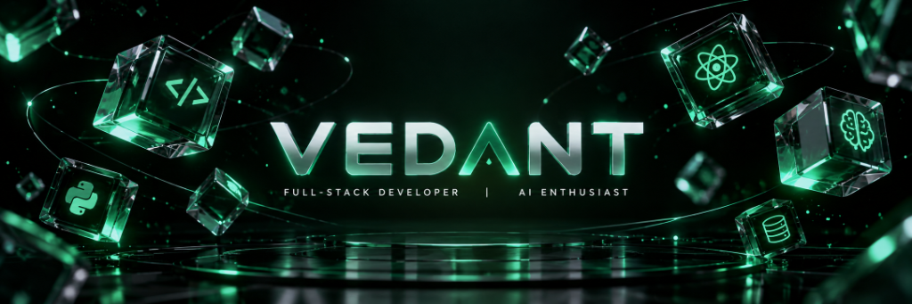
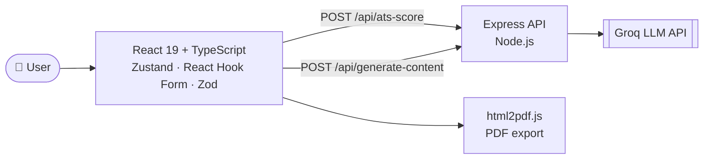

<p align="center">
  
</p>

<h1 align="center">Hey, I'm Vedant Shrivastava 👋</h1>

<p align="center">
  <a href="https://github.com/vedant-175/vedant-175">
    
  </a>
</p>

<p align="center">
  <a href="https://vedant-175.github.io/website/"></a>
  <a href="https://www.linkedin.com/in/vedant-shrivastava175"></a>
  <a href="https://github.com/vedant-175?tab=repositories"></a>
  
</p>

<br/>

## ⚡ The short version

I'm a Computer Science Engineering student who likes shipping things people can actually use. I build full-stack web apps and wire LLMs into them, so AI becomes a feature people use rather than a demo.

```ts
const vedant = {
  role: "CSE Student · Full-Stack Developer",
  focus: ["React + TypeScript", "Node.js APIs", "LLM integration"],
  currentlyBuilding: "AI-powered developer & career tools",
  currentlyLearning: ["System design", "Testing", "Deployment & CI/CD"],
  lookingFor: "Full-stack / AI engineering internships",
  funFact: "I'd rather ship it and iterate than polish it forever.",
};
```

<br/>

## 🛠️ Tech Stack

<p align="center">
  <br/><br/>
  <br/><br/>
  <br/><br/>
  
</p>

<br/>

## 🚀 Featured Project

### 🧠 AI Resume Builder: ATS scoring + AI suggestions + PDF export

> A full-stack app that helps people write better resumes. You build one in a live-preview editor, get an **ATS compatibility score (0–100)** with AI-generated tips to improve it, then export a clean PDF.

<p>
  
  
  
  
  
  
  
</p>

**What's under the hood**

| | |
|---|---|
| 🎯 **ATS analysis** | Resume text goes to an Express endpoint, then to the Groq LLM API, which returns a 0–100 score plus improvement tips |
| 🧩 **Type-safe forms** | React Hook Form + Zod schemas validate every section before it reaches the preview |
| 🗂️ **Predictable state** | Zustand store, with React Query for server state |
| 📄 **Real PDF export** | One-click download generated client-side with html2pdf.js |
| ☁️ **Deployable** | Split frontend/backend, with Render deployment docs included |



<p>
  <a href="https://github.com/vedant-175/AI-resume-builder"></a>
  <!-- ADD WHEN LIVE: <a href="YOUR-LIVE-DEMO-URL"></a> -->
</p>

<br/>

### 🧪 More things I've built

<table>
  <tr>
    <td width="50%" valign="top">
      <h4>🌐 Interactive Developer Portfolio</h4>
      <p>A portfolio exploring 3D visuals, animation and interactive UI.</p>
      <p><sub><b>React · Three.js · React Three Fiber · GSAP</b></sub></p>
      <a href="https://github.com/vedant-175/My-Portfolio-">Code</a> · <a href="https://vedant-175.github.io/website/">Live</a>
    </td>
    <td width="50%" valign="top">
      <h4>🎓 Smart Internship Portal</h4>
      <p>An internship discovery and management web app. See the repo README for implementation details and attribution to the original project.</p>
      <p><sub><b>Web application development</b></sub></p>
      <a href="https://github.com/vedant-175/Smart-Internship-Portal">Code</a>
    </td>
  </tr>
</table>

<br/>

## 📈 GitHub Activity

<p align="center">
  
  
</p>
<p align="center">
  
</p>

<br/>

## 🎯 What I'm working toward

- [x] Ship a full-stack AI app (React + TypeScript + Express + LLM API)
- [x] Build an interactive 3D portfolio
- [ ] Add tests and CI to my main projects
- [ ] Deploy every project with a live demo link
- [ ] Contribute to an open-source project
- [ ] Land a full-stack / AI engineering internship

<br/>

## 🤝 Let's Connect

I'm happy to talk about full-stack development, practical LLM apps, or internship opportunities. Open to collaborating on useful open-source projects too.

<p align="center">
  <a href="https://www.linkedin.com/in/vedant-shrivastava175"></a>
</p>

<p align="center"><i>Build with purpose. Learn continuously. Ship reliable software.</i></p>

<p align="center">
  
</p>
