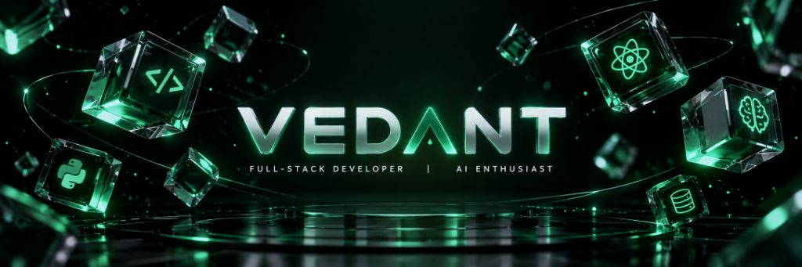
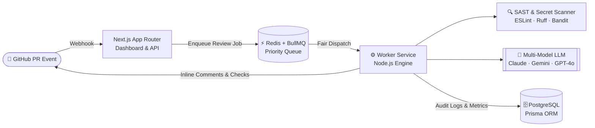
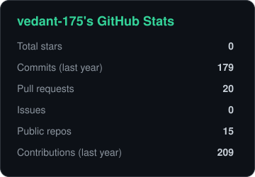
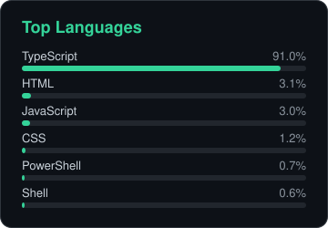
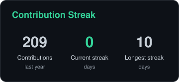

<p align="center">
  
</p>

<h1 align="center">Hey, I'm Vedant Shrivastava 👋</h1>

<p align="center">
  <a href="https://github.com/vedant-175/vedant-175">
    
  </a>
</p>

<p align="center">
  <a href="https://vedant-175.github.io/website/"></a>
  <a href="https://www.linkedin.com/in/vedant-shrivastava175"></a>
  <a href="https://github.com/vedant-175?tab=repositories"></a>
  
</p>

<br/>

## ⚡ The short version

I'm a Computer Science Engineering student who likes shipping things people can actually use. I build full-stack web apps and wire LLMs into them, so AI becomes a feature people use rather than a demo.

```ts
const vedant = {
  role: "CSE Student · Full-Stack Developer",
  focus: ["React + TypeScript", "Node.js APIs", "LLM integration"],
  currentlyBuilding: "GitSentinel · Autonomous AI Code Review & Security Gate",
  currentlyLearning: ["System design", "Distributed systems", "Deployment & CI/CD"],
  lookingFor: "Full-stack / AI engineering internships",
  funFact: "I'd rather ship it and iterate than polish it forever.",
};
```

<br/>

## 🛠️ Tech Stack

<p align="center">
  <br/><br/>
  <br/><br/>
  <br/><br/>
  
</p>

<br/>

## 🚀 Featured Project

### 🛡️ GitSentinel: Autonomous AI Code Review & PR Security Gate

> An enterprise-grade, fail-closed GitHub App and real-time security dashboard that automates Pull Request code reviews. It scans incoming diffs for security vulnerabilities, secrets, and AST lint errors, orchestrates multi-model AI reviews (Claude, Gemini, GPT-4o), and posts inline comments with automated merge gate verdicts.

<p>
  
  
  
  
  
  
  
  
</p>

**What's under the hood**

| | |
|---|---|
| 🛡️ **Fail-Closed Security Gate** | Blocks malicious PRs, hardcoded API secrets, SQL injections, and prompt injections before code ever merges |
| ⚡ **Distributed Queue & Worker** | BullMQ + Redis handles webhook concurrency with jittered exponential backoffs, lease heartbeats, and idempotency locks |
| 🤖 **Multi-Model AI Orchestrator** | Coordinates Claude 3.5 Sonnet, Gemini 1.5 Pro, and GPT-4o with deterministic output validation & fingerprint deduplication |
| 🔍 **Static Analysis (SAST)** | Built-in AST analysis using ESLint, Ruff, Bandit, and dependency vulnerability scanning |
| 📊 **CyberOps Dashboard** | Live telemetry, audit logs, cyber diff inspector, repository health metrics, and interactive AI chatbot |



<p>
  <a href="https://github.com/vedant-175/GitSentinel"></a>
</p>

<br/>

### 🧪 More things I've built

<table>
  <tr>
    <td width="50%" valign="top">
      <h4>🧠 AI Resume Builder</h4>
      <p>A full-stack app that helps people write better resumes with live-preview editor, ATS compatibility scoring (0–100), AI suggestions, and client-side PDF export.</p>
      <p><sub><b>React 19 · TypeScript · Vite · Tailwind · Express · Groq API</b></sub></p>
      <a href="https://github.com/vedant-175/AI-resume-builder">Code</a>
    </td>
    <td width="50%" valign="top">
      <h4>🌐 Interactive Developer Portfolio</h4>
      <p>A personal portfolio exploring 3D visuals, animation, and interactive UI.</p>
      <p><sub><b>React · Three.js · React Three Fiber · GSAP</b></sub></p>
      <a href="https://github.com/vedant-175/My-Portfolio-">Code</a> · <a href="https://vedant-175.github.io/website/">Live</a>
    </td>
  </tr>
  <tr>
    <td width="50%" valign="top">
      <h4>🎓 Smart Internship Portal</h4>
      <p>Capstone MERN app with an AI-powered ATS resume-scoring engine (Groq, Llama 3.3 70B) that falls back to deterministic keyword matching if the API is unavailable. Built with teammates; I worked on the frontend.</p>
      <p><sub><b>React 19 · Vite · Node.js · Express 5 · MongoDB · JWT</b></sub></p>
      <a href="https://github.com/vedant-175/Smart-Internship-portal">Code</a>
    </td>
    <td width="50%" valign="top">
    </td>
  </tr>
</table>

<br/>

## 📈 GitHub Stats

<p align="center">
  
</p>
<p align="center">
  
  
</p>

<br/>

## 🏆 Achievements & Community

- 🎓 **Google Gemini Student Ambassador** (since Sep 2026)
- 🌱 **GSSoC'26 Ambassador & Contributor** (May–Aug 2026)
- 🏁 **Web-a-Thon 2.0 Finalist**, one of 100 teams (Feb 2026)
- 🏁 **Code-a-Haunt 2.0 Finalist** (Feb 2025)
- 🎓 B.Tech CSE at Lovely Professional University · CGPA 8.54

<br/>

## 🎯 What I'm working toward

- [x] Ship GitSentinel: Autonomous AI PR Code Review & Security Gate
- [x] Build an AI Resume Builder (React + TS + Groq API)
- [x] Build an interactive 3D portfolio
- [ ] Add tests and CI to all main projects
- [ ] Deploy every project with a live demo link
- [x] Contribute to open source (GSSoC'26)
- [ ] Land a full-stack / AI engineering internship

<br/>

## 🤝 Let's Connect

I'm happy to talk about full-stack development, practical LLM apps, or internship opportunities. Open to collaborating on useful open-source projects too.

<p align="center">
  <a href="https://www.linkedin.com/in/vedant-shrivastava175"></a>
</p>

<p align="center"><i>Build with purpose. Learn continuously. Ship reliable software.</i></p>

<p align="center">
  
</p>
